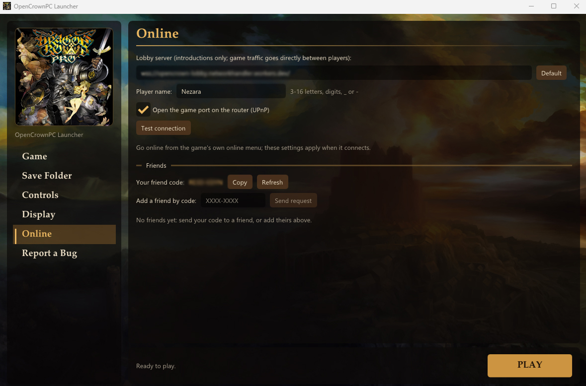
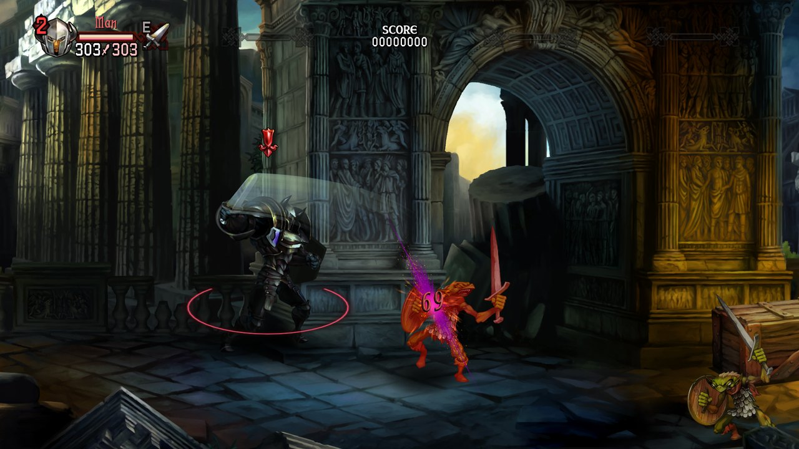
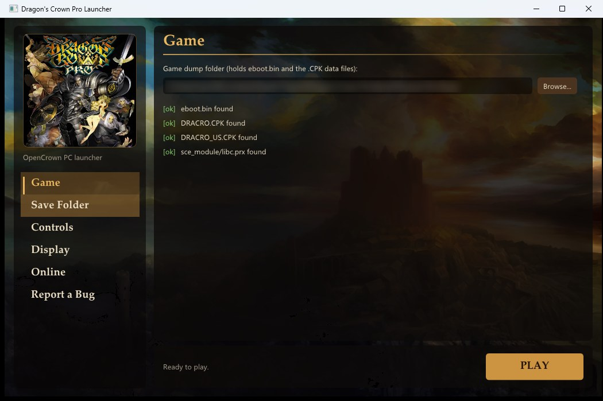
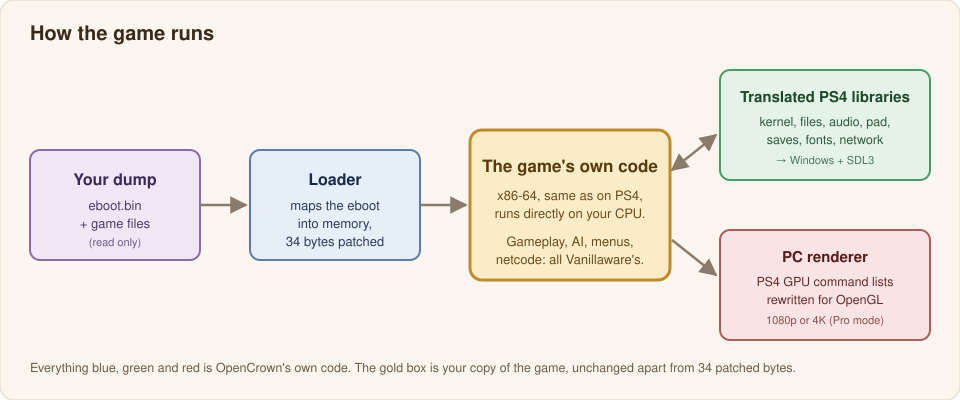
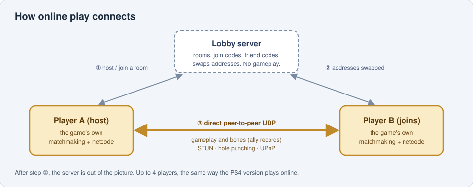

<h1 align="center">OpenCrown PC</h1>

<p align="center"><i>Dragon's Crown Pro Multiplayer Port, running natively on Windows, Linux and Steam Deck</i></p>

<p align="center">
  
</p>

<p align="center">
  <a href="https://github.com/Nezara/OpenCrown-PC/releases/latest"></a>
  
  
  
  <a href="https://discord.gg/srBT23NYRA"></a>
</p>

<p align="center">
  <b><a href="#getting-started">Getting started</a></b> ·
  <a href="#linux--steam-deck">Linux / Steam Deck</a> ·
  <a href="#the-launcher">Launcher</a> ·
  <a href="#controls">Controls</a> ·
  <a href="#playing-online">Online</a> ·
  <a href="#how-it-works">How it works</a> ·
  <a href="#building-from-source">Building</a> ·
  <a href="#faq">FAQ</a>
</p>

---

**OpenCrown PC** lets you play **Dragon's Crown Pro** on a Windows PC, on Linux or on a Steam Deck from a dump of your own PS4/PS5 copy. It is a native launcher, not an emulator: the game's own code runs directly on your CPU, while OpenCrown provides the PS4 system libraries, the renderer, input, saves and online play.

This is a hobby project made by one person with AI assistance ([details below](#made-with-ai-assistance-)). It isn't affiliated with or endorsed by Vanillaware, Atlus or Sony.

> [!IMPORTANT]
> **No game files are included, and none will ever be.** You need your own dump of Dragon's Crown Pro (CUSA10454). See [Your dump](#your-dump).

## Support the people who made it

Dragon's Crown Pro is a beautiful game made by a small studio. If you enjoy it here, please make sure they get paid for it.

- 🛒 **Buy Dragon's Crown Pro** on the [PlayStation Store](https://store.playstation.com/en-us/product/UP2611-CUSA10454_00-DRAGONSCROWNPRO1).
- 🦄 **Play Unicorn Overlord**, Vanillaware's tactical RPG, on the [PlayStation Store](https://store.playstation.com/en-us/product/UP0177-PPSA09770_00-UNICORNOVERLORD0).
- ⚔️ **Support Vanillaware's latest game**, [Muramasa: Revenant Blades on Steam](https://store.steampowered.com/app/4253770/Muramasa_Revenant_Blades/). It's the best way to tell them there's a PC audience for their games.

## Made with AI assistance 🤖

> [!IMPORTANT]
> **OpenCrown PC was built with help from AI.** Much of the code and the reverse-engineering behind it was written by **Claude**, Anthropic's AI model. **Nezara** led the project: set the direction, decided what went in, and tested, hunted bugs and diagnosed problems on every build. The full source is public, so you can see exactly what's here.

## Features

- 🖥️ **Runs natively on Windows and Linux.** No PS4 emulator; the game's code runs as a regular Windows or Linux program.
- 🕹️ **Steam Deck ready.** One AppImage file, playable from Game Mode: the launcher works with the controller and touch screen, the right trackpad steers the fairy pointer and tapping the screen sends the fairy to that spot.
- 🎨 **Rewritten renderer** for OpenGL 3.3, at 1080p or **4K** (the PS4 Pro mode).
- 🎮 **Gamepads** (Xbox, DualShock / DualSense and others through SDL3), up to 4 local players, with rumble.
- ⌨️ **Keyboard and mouse** with mouse attacks and the fairy pointer on the mouse, all rebindable.
- 🔄 **Dynamic button prompts.** On-screen prompts switch between PlayStation buttons and your keyboard / mouse keys, following whichever you used last, and show your own bindings.
- 💾 **PS4/PS5-compatible saves.** Save files are byte-identical to the console's, so you can bring your PS4/PS5 progress over and take it back.
- 🌐 **Online co-op** for up to 4 players, using the game's own netcode over direct peer-to-peer connections, with room codes and friend codes.
- ⏭️ **Optional story and tutorial skip** on new characters (details [below](#what-is-changed-in-the-game)).
- 🪟 **Launcher** for your dump, saves, controls, display, online settings and bug reports.
- 🔄 **Built-in updates.** The launcher tells you when a new version is out, shows what changed and installs it with one click.

## Screenshots

<table>
  <tr>
    <td width="50%"></td>
    <td width="50%"></td>
  </tr>
  <tr>
    <td align="center"><sub>Stage 1, the Ancient Temple</sub></td>
    <td align="center"><sub>The launcher, ready to play</sub></td>
  </tr>
</table>

<sub>All screenshots are from OpenCrown running a personal dump. The game art belongs to Vanillaware / Atlus.</sub>

## Requirements

| | |
|---|---|
| **OS** | Windows 10 or 11, 64-bit, **or** 64-bit Linux with glibc 2.35+ (Steam Deck / SteamOS 3.5+, Ubuntu 22.04+, Debian 12+, Fedora, Arch, ...) |
| **Android (beta)** | Android 9+, 64-bit ARM CPU, Vulkan 1.1, and your own decrypted PS Vita dump (PCSE00019) with the 1.09 update. See [Android](#android-beta). |
| **GPU** | Anything with OpenGL 3.3 (most GPUs from the last ~12 years) |
| **CPU** | A modern x86-64 CPU (the game's code runs on it directly) |
| **Game** | Your own dump of **Dragon's Crown Pro (CUSA10454)** |
| **Online** | An Internet connection. UPnP on your router helps but isn't required. |

## Your dump

OpenCrown needs the game's files from **a PS4 or PS5 you own**: the **decrypted** `eboot.bin` together with the rest of the game folder (the files the game reads at run time and the `sce_sys` folder).

> [!WARNING]
> **PKG files won't work.** A PKG from the PS4/PS5 or the PlayStation Store is encrypted. OpenCrown can't decrypt it, and it never will. It also won't help you get the game any other way. Dump the copy you own with the usual homebrew tools for your console.

For **OpenCrown Mobile** on Android you need a **PS Vita** dump instead (base game + 1.09 update, decrypted): see [Android](#android-beta).

Your dump is only ever **read**. OpenCrown never writes to it or modifies it; the small patches described below (34 bytes in total) are applied in memory each time you play.

## Getting started

### Windows

1. **Download** the latest `OpenCrownPC-*-win64.zip` from [Releases](https://github.com/Nezara/OpenCrown-PC/releases/latest).
2. **Unzip** it anywhere, for example `C:\Games\OpenCrownPC`. Keep the three files together: `OpenCrownPC Launcher.exe`, `dcp_run.exe` and `SDL3.dll`.
3. **Run `OpenCrownPC Launcher.exe`.** Windows SmartScreen may warn you because the program isn't code-signed (it's a hobby project). Click *More info → Run anyway*.
4. On the **Game** page, **browse to your dump folder** (the one containing `eboot.bin`). The launcher checks the folder and tells you if anything is missing.
5. The first time, it asks **where to keep your saves**. The default is `Documents\Dragons Crown Pro\saves`.
6. Press **Play**. 🎉

Your settings, saves and logs all live in `Documents\Dragons Crown Pro\` unless you choose a different save folder.

### Linux / Steam Deck

Everything is in one file: `OpenCrown-Linux-*-x86_64.AppImage` from [Releases](https://github.com/Nezara/OpenCrown-PC/releases/latest). Nothing to install, no root needed.

**Desktop Linux**

1. **Download** the AppImage and put it wherever you like, for example `~/Games/OpenCrown/`.
2. **Make it executable:** right-click it → *Properties* → *Permissions* → *Allow executing file as program*, or in a terminal:
   ```bash
   chmod +x OpenCrown-Linux-*-x86_64.AppImage
   ```
3. **Run it** (double-click, or `./OpenCrown-Linux-*-x86_64.AppImage`).
4. On the **Game** page, **browse to your dump folder**, choose where your saves go the first time, and press **Play**. 🎉

**Steam Deck**

1. Hold the power button → **Switch to Desktop**.
2. Copy the AppImage and your dump folder to the Deck (internal storage or the SD card both work), for example with a USB stick or over the network.
3. In the file manager (Dolphin), right-click the AppImage → *Properties* → *Permissions* → tick *Is executable*.
4. Open **Steam** → *Games* → **Add a Non-Steam Game to My Library…** → *Browse…* → pick the AppImage → **Add Selected Programs**.
5. Switch back to **Game Mode** (the *Return to Gaming Mode* icon on the desktop) and start **OpenCrown** from your library.
6. The launcher works with the controller: **D-pad / stick** to move, **A** to select, **B** to go back, **L1 / R1** to switch pages, **Start** to play. On the **Game** page use **Browse** to find your dump; folders with a complete dump are marked **[dump]** (the SD card has its own button). Press **Steam + X** if you need the on-screen keyboard.
7. In the game, **tap the touch screen** to send the fairy pointer there and interact (doors, chests); drag to move it. On a Steam Deck the controller is the main input: mouse clicks never attack. With Steam Input on, add **Touchscreen Native Support** to the shortcut's controller layout (*Action Sets → Add Always-On command → System*) so the game gets real touches.

On Linux, settings, saves and logs live in `~/.local/share/OpenCrown/`. Updating through the launcher replaces the AppImage in place, so your Steam shortcut keeps working (the file name keeps its old version number; that's expected).

### Android (beta)

**OpenCrown Mobile** runs the game's **PS Vita** version on Android. It's lighter to run (960×544, a quarter of the pixels of 1080p) and cheaper to translate on phone CPUs (32-bit ARM to 64-bit ARM instead of x86-64). The game already supports touch, and a Vita is far easier to dump than a PS4. It plays online together with OpenCrown PC, and saves move between the two with no conversion.

**What you need**

- An **Android 9 or newer** phone, tablet or handheld with a **64-bit ARM CPU** and **Vulkan 1.1**. A controller is recommended; on-screen controls appear while none is connected.
- Your own **decrypted** dump of **Dragon's Crown for PS Vita (US, PCSE00019)**: **both** the base game **and** the **1.09 update**. Each one is a folder:

> [!WARNING]
> **The dump must be decrypted.** A copy straight from a game card, a `.vpk`, a PKG or a folder that still has an `sce_pfs/` folder inside is encrypted, and OpenCrown can't decrypt it and never will. Update your Vita to **1.09** (older updates are refused), then dump the game and the update you own with the usual Vita homebrew tools. Other regions aren't supported yet.

**Install**

1. **Download** `OpenCrownMobile-*-arm64.apk` from [Releases](https://github.com/Nezara/OpenCrown-PC/releases/latest) on the device (or copy it over from your PC).
2. **Open the APK** and tap **Install**. The first time, Android asks you to allow installing apps from your browser or file manager: allow it, go back and install. The app isn't from the Play Store, so Play Protect may warn you; choose *Install anyway*.
3. **Start OpenCrown Mobile** once. When it asks for **All files access**, allow it (it needs it to read the game files you copy in). It creates the folder `Internal storage/OpenCrown/` with `dump/Game/` and `dump/Update/` inside.
4. **Copy your dump to the device.** Connect it to your PC with a USB cable and choose *File transfer* on the device, then on the PC open the device's `Internal storage/OpenCrown/dump/`:
   - copy the **contents** of the base game folder into `dump/Game/`, and
   - copy the **contents** of the 1.09 update folder into `dump/Update/`.

   A VitaShell-style layout works too: copy the `app/PCSE00019` and `patch/PCSE00019` folders into `dump/` as they are.
5. Back in the launcher, press **Check again** on the **Game** page. Both lines should start with **[ok]** (base game 01.00 and update 1.09 found); if not, the line says what's missing.
6. Press **Play**. 🎉

**Saves.** On the **Save Folder** page, **Import PC save** brings in a save from OpenCrown on PC (`Documents\Dragons Crown Pro\saves\SAVEDATA00\SAVE0.DAT`; your current save is backed up first), and **Export save** sends your Mobile save wherever you pick (Downloads, a USB stick, Google Drive, ...) to put into that same folder on the PC. No conversion is needed either way.

**Playing.** A controller works like on a Vita, and its buttons can be changed on the **Controls** page. Without a controller, use the on-screen controls; touching the screen moves the fairy pointer. In town, tapping the screen opens the Town Map: that's how the Vita version works. Online play (the **Online** page) uses the same lobby as OpenCrown PC and starts at the stables in town.

Saves, settings and `log.txt` live in `Internal storage/OpenCrown/`. More details in [`android-port/README.md`](android-port/README.md).

## The launcher

The launcher is a small window with a sidebar. Once your dump is set, it uses the game's own artwork from your dump, so the exe itself contains no game art.

| Page | What it does |
|---|---|
| **Game** | Choose and check your dump folder, then press **Play**. The game starts in its own window; the launcher writes everything it prints to `logs\last_run.log`. |
| **Controls** | Rebind every keyboard and mouse action and adjust the fairy pointer speed. Saved to `input.ini`, which you can also edit by hand. Delete it to restore the defaults. |
| **Display** | Windowed or borderless fullscreen, window size, and **4K rendering** (PS4 Pro mode). |
| **Online** | Your online name, your **friend code**, adding friends by code, incoming and outgoing friend requests, UPnP, a connection test and the lobby server address. |
| **Save Folder** | Where your saves live. Point it at a folder with a `SAVEDATA00` from your PS4/PS5 to keep playing your console progress. |
| **Report a Bug** | Sends a short note, your OS name and version, and the end of your last log, so problems can be fixed. You can **preview** exactly what is sent first. See [Privacy](#privacy). |
| **Update** | At the bottom left. Shows whether a new version is out and what it fixes; **Download and install** updates OpenCrown in place (the download is checked against its SHA-256 first). The automatic check at start can be switched off there. |

Launcher settings are stored in `launcher.ini` next to your saves and logs.

## Controls

Gamepads work out of the box with the PS4 layout. Keyboard and mouse defaults are below; everything can be changed on the **Controls** page.

| Action | Default | | Action | Default |
|---|---|---|---|---|
| Move | **W A S D** | | Attack (□) | **Left mouse** |
| Jump (✕) | **Space** | | Special (○) | **Right mouse** |
| Item / interact (△) | **E** | | Evade / L1 · R1 | **Left Shift** |
| L2 / R2 | **Z** / **C** | | L3 / R3 | **Left Ctrl** / **V** |
| D-pad | **Arrow keys** | | Pause (Options) | **Esc** |
| Character menu (touchpad) | **Tab** | | Town map | **M** |
| Look / right stick | **I J K L** | | Fairy pointer | **Hold middle mouse** |

**The fairy pointer:** hold the middle mouse button and move the mouse to steer Rannie's fairy to treasure, doors and runes. Press **E** to tap while pointing. Mouse attacks are paused while you hold it. If you'd rather not hold a button, you can set an on/off key.

**Button prompts follow you:** the game's on-screen prompts ("Press ✕", "Press TOUCHPAD to open Town Map" and so on) show PlayStation buttons while you use a gamepad. As soon as you touch the keyboard or mouse they switch to key caps and mouse icons labelled with your current bindings, and they switch back when you pick the pad up again. The key and mouse icons are OpenCrown's own drawings; the renderer swaps them in for the game's button sprites.

**Steam Deck and touch screens:** with Steam Input on (the normal case when you start it from Steam), the sticks and buttons work like a PS4 pad, the **right trackpad** moves the fairy pointer and clicking it interacts. With Steam Input off, the right trackpad is the fairy pointer and a **left trackpad click** opens the town map. **Tapping the touch screen** sends the fairy straight to that spot, and a short tap also interacts. Both can be switched off on the **Controls** page.

**Handy extra:** **F1** shows performance stats in the window title.

## Saves

Saves use the PS4's own format, byte for byte, so the same files work on your console, on PS4 emulators and here. Windows and Linux use the same files too. To continue a console playthrough, copy your `SAVEDATA00` folder into your OpenCrown save folder (or point the **Save Folder** page at it). Copy it back the same way.

Keep a backup of your saves before moving them between devices. It's free insurance.

## What is changed in the game

Very little. The PS4 system libraries the game calls (kernel, file system, audio, controller, saves, fonts, networking) are **translated** to Windows or Linux equivalents, and the PS4 **renderer is rewritten** to draw the game's frames with OpenGL. **Everything else is the game's own native code**, running unchanged.

The game's code is patched in **six places, 34 bytes in total**. The patches are applied in memory each time you play and never written to your dump:

- **Story skip** (2 bytes). The game has its own "start from the second half" skip, but it normally only offers it once a class has cleared the game. One 2-byte change offers it to every new character.
- **Skip reminder** (26 bytes in four places). If you say no to the story skip, the game asks once more with a reminder that online play unlocks partway through the story, then respects your answer. Four small jumps send the game to a few lines of OpenCrown's own code that show the reminder.
- **Tutorial question** (6 bytes). Instead of starting the tutorial automatically, the game asks *"Begin the tutorial?"* on a save's first character.

Each patch checks that the original bytes are exactly what it expects first; if they aren't, it leaves that spot alone.

## How it works

<p align="center">
  
</p>

The PS4 and a PC share the same kind of processor (x86-64), so the game's machine code doesn't need to be emulated or recompiled. OpenCrown's **loader** reads your decrypted `eboot.bin`, maps it into memory the way the PS4 would, links the game's calls to the system libraries to OpenCrown's own implementations, and then jumps into the game's entry point.

From there the game runs exactly as it was written. Whenever it asks the "PS4" for something (open a file, play a sound, read the controller, save the game, draw a frame), the request goes to OpenCrown's code, which does the same job with Windows or Linux, SDL3 and OpenGL. The renderer is the biggest piece: the game hands over PS4 GPU command lists, and OpenCrown turns them into OpenGL draws, decoding the PS4's tiled textures and shaders along the way.

The `dcp_run.exe` next to the launcher is the program that actually runs the game; the launcher sets things up and starts it for you.

## Playing online

<p align="center">
  
</p>

Online play uses **the game's own matchmaking and netcode**. The lobby server only introduces players to each other:

1. **Host or join a room.** When you go online in the game, it opens a room on the lobby server. Others can find it in the room list, or join with a **room code** or from your **friends** list.
2. **Handshake.** The server swaps the players' network addresses so they can reach each other.
3. **Peer to peer.** The players connect **directly** over UDP. All gameplay traffic goes between the players, never through the server. NAT traversal uses STUN and hole punching, plus UPnP if your router allows it.

**Bones** (the ally records you find in the catacombs and resurrect at the temple) are swapped by the game itself over that same peer connection when a stage starts, just like on PS4/PS5. There's no central bones database.

The lobby is a small open-source Cloudflare Worker that lives in [`server/lobby-worker`](server/lobby-worker). Anyone can run their own and point the **Online** page at it.

**Friends:** each player has a friend code like `ABCD-1234`. Add someone by their code on the **Online** page. Once they accept, you can see when they're online and use *Join Friend's Room* in the game.

> [!NOTE]
> Online play unlocks at the same point in the story as on PS4/PS5. Taking the story skip on a new character gets you there right away.

## Privacy

- **The lobby server sees:** your online name, a random account ID, your public IP and port (needed to connect players), your rooms and your friends list. It doesn't see or relay gameplay.
- **Other players see:** your online name and your IP address, the same as in any peer-to-peer game.
- **Bug reports** contain your short note, your operating system's name and version (for example `Windows 11 24H2`, `SteamOS 3.6` or `Android 14`; nothing that identifies your device) and the last part of `last_run.log`. Before sending, your Windows user name, PC name, home folder path and account secret are scrubbed out, and you can preview the whole report first. Reports are rate limited and only kept to fix bugs.
- **Update check:** when the launcher starts it asks GitHub for the list of releases (GitHub sees your IP, nothing else is sent). You can switch this off on the **Update** page.
- Nothing else is sent anywhere unless you go online or send a bug report.

## Known issues

This is an early release from a hobby project, so expect a few rough edges:

- **Two players behind the same router** may not be able to connect to each other yet. Different houses work fine.
- **Very strict networks** (some mobile or carrier-grade NAT connections) can stop the direct connection. There's no relay server yet.
- **Friend status** can take about 10 seconds to update.
- **Windows user names with non-English characters** (e.g. `C:\Users\Jürgen`) can break file paths. Choosing a save folder with a plain path works around it.
- **Odd or unusual text can appear briefly on scene transitions.** The PS4's system text library isn't included, so some of the text it would supply has to be swapped for generic stand-in text. Most of these cases have been caught and fixed, but a few outliers may still slip through. If you spot one, a bug report saying where it happened helps.
- The programs **aren't code-signed**, so SmartScreen and some antivirus tools may be suspicious at first.
- **Linux / Steam Deck is brand new.** It has been tested on Ubuntu 22.04, but not yet on a real Steam Deck or on other desktops and distros. Feedback through **Report a Bug** or Discord is very welcome.
- **Running the Windows version through Proton isn't supported.** On Linux and the Steam Deck, use the AppImage.

Found something else? Use the launcher's **Report a Bug** page or [open an issue](https://github.com/Nezara/OpenCrown-PC/issues).

## Building from source

You'll need:

- **CMake** 3.24+ and **Ninja**
- **MinGW-w64 GCC** (UCRT build, e.g. [WinLibs](https://winlibs.com/)) with C++20 support

SDL3, Dear ImGui, FreeType and the other dependencies are downloaded by CMake on the first configure.

```bash
cmake -S port -B port/build -G Ninja
cmake --build port/build
```

That gives you `OpenCrownPC Launcher.exe`, `dcp_run.exe` and `SDL3.dll` in `port/build`, plus a few developer tools (`dcp_cpk`, `dcp_tex`, `dcp_audio`, `dcp_viewer`, ...) and the tests (`test_*.exe`). The tests run without any game files.

**Linux:** the Linux build lives in [`linux-port/`](linux-port) (Ubuntu 22.04 or newer: install the packages listed in [`linux-port/README.md`](linux-port/README.md), then run `./build.sh`; `sh packaging/make-appimage.sh` makes the AppImage).

**Android (beta):** OpenCrown Mobile lives in [`android-port/`](android-port). It runs the game's PS Vita version from your own Vita dump and plays online with OpenCrown PC; see [`android-port/README.md`](android-port/README.md).

The lobby server builds and tests separately with Node.js; see [`server/lobby-worker/README.md`](server/lobby-worker/README.md).

### Repository layout

| Folder | What's inside |
|---|---|
| `port/src/loader` | Loads the eboot and links it against our libraries |
| `port/src/hle` | The translated PS4 system libraries |
| `port/src/render` | The rewritten renderer (PS4 GPU → OpenGL) |
| `port/src/formats` | Readers for the game's file formats (CPK archives, textures, audio, ...) |
| `port/src/net` | Lobby client, peer-to-peer transport, STUN / UPnP, friends |
| `port/tools` | The launcher, `dcp_run` and developer tools |
| `port/tests` | Unit tests (synthetic data only, no game files) |
| `linux-port` | The Linux / Steam Deck build (its own copy of the above, adapted for Linux) and its AppImage packaging |
| `android-port` | OpenCrown Mobile for Android (beta): the PS Vita version under an ARM JIT, Vulkan renderer, Android launcher |
| `server/lobby-worker` | The lobby server (Cloudflare Worker, TypeScript) |
| `notes/map` | Reverse-engineering notes on how the game's systems work |

## FAQ

<details>
<summary><b>Is this an emulator?</b></summary>

No. An emulator pretends to be the whole console. OpenCrown runs the game's own code directly and only replaces the PS4 parts it talks to (system libraries and graphics). That's why it can be small and fast, but it also means it only runs Dragon's Crown Pro.
</details>

<details>
<summary><b>Can I download the game somewhere and use it?</b></summary>

No. Please buy the game and dump your own copy. This project won't link to, host or help with pirated copies, and it can't decrypt PKG files.
</details>

<details>
<summary><b>Can I play online with people on a real PS4/PS5?</b></summary>

No. OpenCrown players play with each other through the OpenCrown lobby. PlayStation Network isn't involved.
</details>

<details>
<summary><b>Will my PS4/PS5 save work?</b></summary>

Yes. Copy your `SAVEDATA00` folder into the save folder. The format is identical, and it works the other way round too.
</details>

<details>
<summary><b>Does it run on the Steam Deck?</b></summary>

Yes, with the Linux AppImage (see [Linux / Steam Deck](#linux--steam-deck)). Add it to Steam as a non-Steam game and it runs from Game Mode, launcher included, with the controller and touch screen. Please use the AppImage rather than the Windows version through Proton.
</details>

<details>
<summary><b>Are there cheats or trainers?</b></summary>

No, and there won't be. The goal is to play the game as it was made.
</details>

<details>
<summary><b>Why is SmartScreen / my antivirus warning me?</b></summary>

The programs aren't code-signed (signing certificates cost money), and a program that loads another program's code into memory looks unusual to antivirus heuristics. The full source is right here if you'd like to check it or build it yourself.
</details>

## Credits

- **Vanillaware** and **Atlus** for making Dragon's Crown, a game that's still gorgeous years later.
- **Nezara**, project lead, bug hunting, diagnosing and a lot of testing, again and again and again. 
- **Claude** (Anthropic), coding and reverse-engineering contributor.
- The [shadPS4](https://github.com/shadps4-emu/shadPS4) project, used as a reference to compare against during early stages of development. 
- [SDL](https://www.libsdl.org/), [Dear ImGui](https://github.com/ocornut/imgui), [FreeType](https://freetype.org/), [MiniUPnPc](https://miniupnp.tuxfamily.org/) and [Mbed TLS](https://github.com/Mbed-TLS/mbedtls), which make this possible.

## Legal

*Dragon's Crown* and *Dragon's Crown Pro* are trademarks of their respective owners. OpenCrown PC is an independent, non-commercial fan project. The repository contains no code, art, audio or other data from the game (apart from the screenshots above, shown to illustrate the project), and it requires a legally obtained copy that you dumped yourself. It is not affiliated with or endorsed by Vanillaware, Atlus, SEGA or Sony Interactive Entertainment.

## Help keep the server running

OpenCrown is free and always will be. Donations will go toward upgrading the server and any ongoing server maintenance. Any overflow will go towards building more resources for the community; there are no perks, rewards or early builds, and everyone gets the same thing whether they donate or not.

<p align="center">
  <a href="https://ko-fi.com/nezara"></a>
</p>
